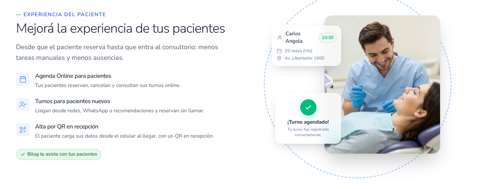
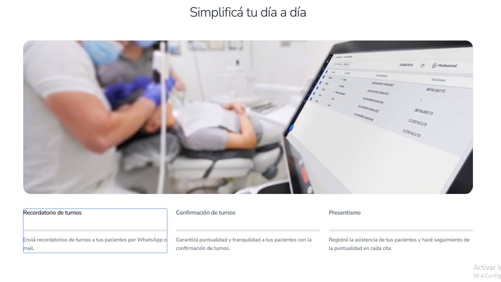
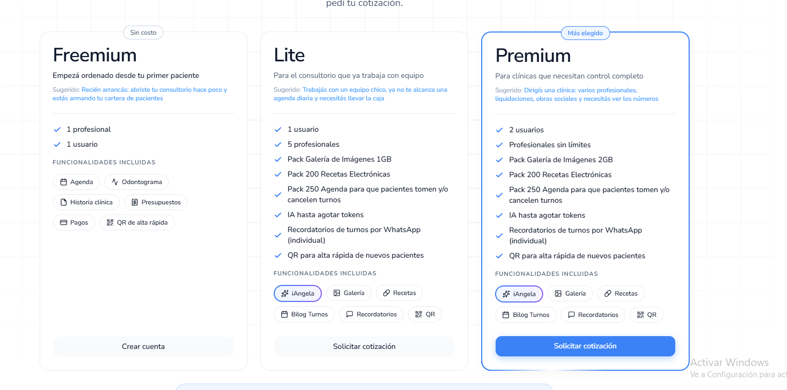

# Verificación: Bilog

- **Responsable**: Emanuel
- **URL**: https://bilog.com.ar/
- **Tipo de fuente**: <sitio oficial | precios >
- **Fecha y hora de consulta**: 2026-11-21 11:20

## Qué afirma el informe
+1.500 clínicas; reserva y cancelación online; recordatorios por WhatsApp; sin precios publicados

## Qué encontré
- Afirmación 1 (+1.500 clínicas): ✅ coincide. Detalle: Nada para aclarar, solo que si lo dice en la pagina.
- Afirmación 2 (reserva y cancelación online): ✅ coincide. Detalle: Los pacientes pueden reservar, cancelar y consultar sus turnos online, los pacientes nuevos tambien pueden reservar un turno online y el paciente carga sus datos desde el celular al llegar, con un QR en recepción.
- Afirmacion 3 (recordatorios por WhatsApp): ✅ coincide. Detalle: El sistema envia recordatorios por whatsapp y cabe aclarar que por mail tambien
- Afirmacion 4 (sin precios publicados): ✅ coincide. Detalle: El precio solo se puede solicitar y es necesario contactarse con los proveedores del software para conocerlo.

## Corrección propuesta
"ninguna"

## Evidencia
Afirmacion 2

Afirmacion 3

Afirmacion 4
