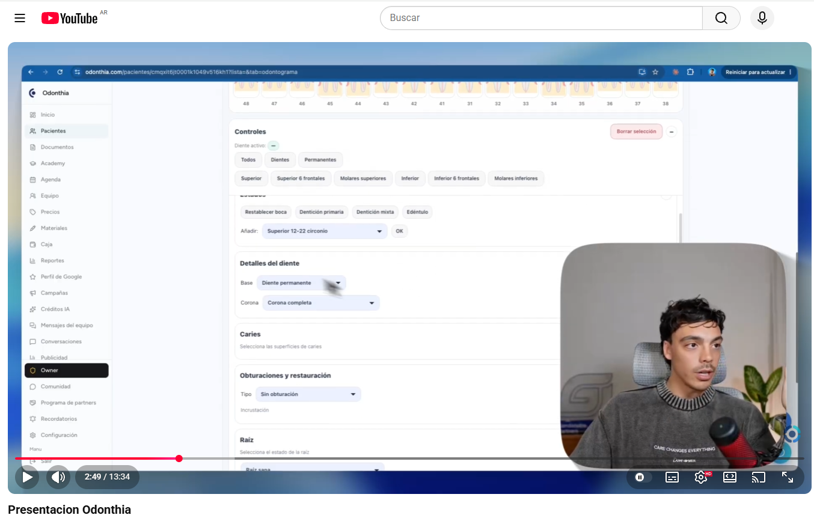

# Verificación: Odonthia

- **Responsable**: Enzo
- **URL**: https://odonthia.com/ 
- **Tipo de fuente**: video | sitio oficial
- **Fecha y hora de consulta**: 2026-11-20 16:45

## Qué afirma el informe
Odontograma FDI con dientes temporales; plan gratuito permanente

## Qué encontré
- Afirmación 1 (Odontograma FDI con dientes temporales): ✅ coincide. Detalle: en el video (min 2:44) se ve el odontograma con numeración FDI - ISO 3950 y, en el min 2:49, los controles dentición primaria, dentición mixta y edéntulo. El video no muestra los dientes temporales dibujados en pantalla, pero la página oficial (odonthia.com) confirma por escrito que el odontograma incluye dientes temporales.
- Afirmación 2 (plan gratuito permanente): ✅ coincide. Detalle: verificado en la página oficial, no en el video. El plan Odonthia Gratis figura como sin tarjeta y sin vencimiento, sin límite de pacientes; el FAQ promete que lo que ya se usa no se va a cobrar. Lo gratuito es la gestión del consultorio (pacientes, ficha, odontograma, agenda, documentos). La IA (solo 2 consultas de prueba en el plan gratis), el WhatsApp automático y los mensajes internos del equipo son de pago (Odonthia IA ARS 77.100/mes, Max ARS 159.100/mes; fuera de Argentina USD 47 y USD 97).

## Corrección propuesta
Ninguna. Opcional: aclarar en el informe que el plan gratuito cubre la gestión del consultorio y que la IA, el WhatsApp automático y los mensajes internos son pagos.

## Evidencia
